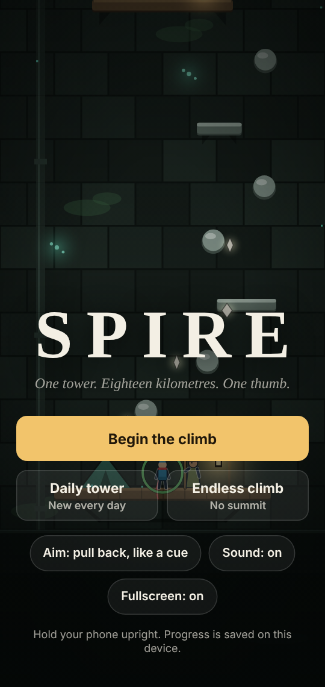
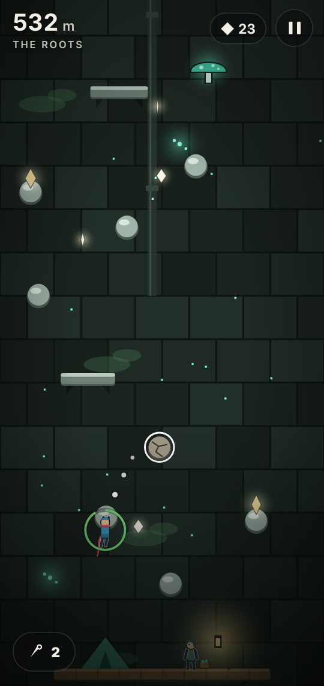
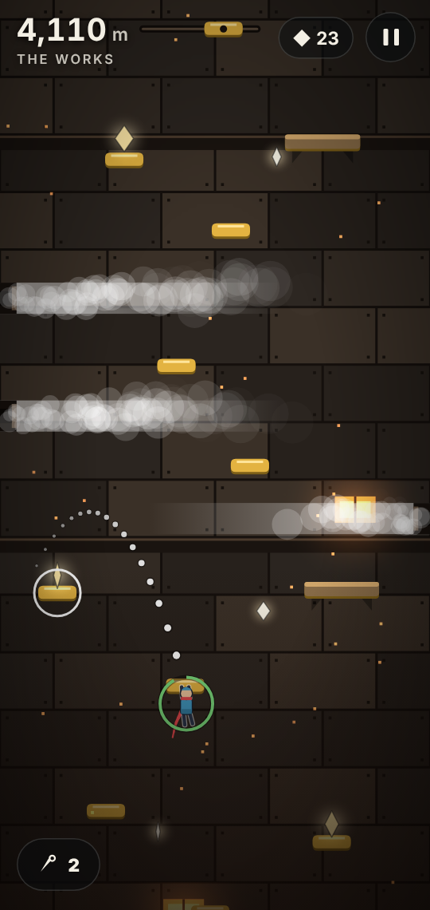
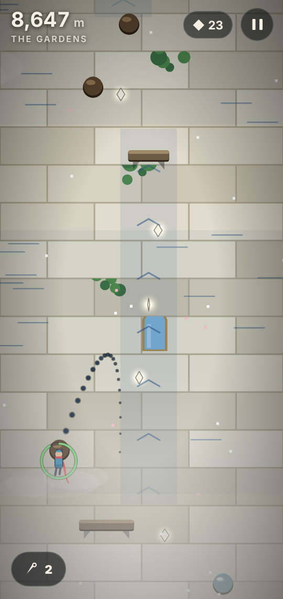
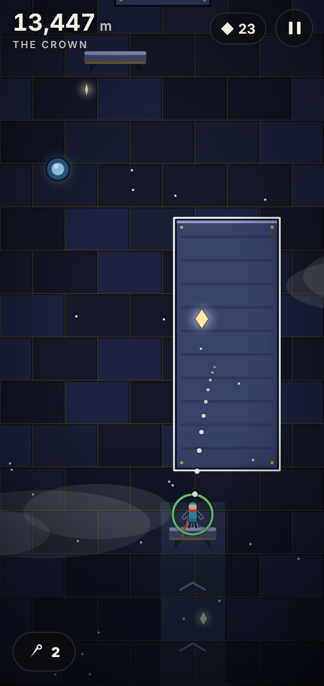

# Spire

A one-thumb climbing adventure up a single colossal tower, built for phones in portrait mode.
Plain HTML, CSS and JavaScript: no build step, no dependencies, no image or audio files.

**Play:** https://z0rug1.github.io/Spire/ (once GitHub Pages is switched on, see below)

<p>
  
  
  
  
  
</p>

## Ways to climb

- **The story.** You are a courier from the Roots, the lowest floors of a tower about thirty-five kilometres
  tall. The water that flows down from the Crown is failing, and nobody has heard from the Crown in
  a generation. Six districts (the Roots, the Cisterns, the Works, the Gardens, the Archive and the
  Crown), 25 camps with the people who live there, two bivouacs between every pair of camps, three
  faction choices and
  three endings, one of them hidden. Camps sell upgrades for the chalk you collect, and a tailor
  sells scarves, glider skins and trails.
- **The daily tower.** A new short tower every day, the same for everyone, at the same base stats.
  It is timed, and a ghost of your best run that day climbs alongside you.
- **The endless climb.** A wall with no summit that keeps getting built above you. You have three
  ropes: a fall costs one, and every second camp gives one back along with a choice of three perks
  (air hop, longer grapple, slower slag and so on). Your best height is kept.
- **Lost letters.** Twenty letters hidden on side routes, six of them locked in strongboxes whose
  keys lie further down. Read in order, they tell how the Crown emptied and who kept its voice.
- **New Game+.** After an ending: the story again on a remixed, harder tower, keeping your
  upgrades, looks and letters.
- **Challenge climbs.** Once the story has an ending: the story tower again with modifiers (no
  pitons, lights out, thin air), a clock, and a split at every district gate.

## What is on the wall

| | |
| --- | --- |
| Holds and ledges | Hanging drains your grip; ledges, bivouacs and camps restore it |
| Cracked holds | Crumble a second after you grab them |
| Piston holds, lift hooks | Slide sideways, or ride a rail upward and wait a moment at each end |
| Phase holds | Come and go; a flicker means one is about to vanish |
| Bounce caps | Throw you straight up to the hold above |
| Pneumatic tubes | Drop into the funnel, get fired out of the far end |
| Steam vents, wind bands, wet holds | Knock you off, bend your leap, drain grip faster |
| Slag drips, wall-swifts, patrol drones | Moving hazards on a fixed rhythm: wait for the gap |
| Grapple rings (the Works onward) | Tap one to be hauled in |
| Updrafts (the Gardens onward) | Lift you while you glide |
| Steel plates (the Crown) | Magnet gloves catch at the top of each hop; some plates go live |
| Mill wheels | Catch a handhold at the bottom, ride it up, leap off near the top |
| Bells and gold holds | Leap off a bell and the gold holds that answer it are solid for a few seconds |
| Keys and strongboxes | Carry a key up to a strongbox for chalk and a locked letter |
| Sluice levers and blue/amber holds (the Cisterns onward) | A lever flips which colour is solid; faded holds are the other colour. Decoys with chalk tempt you the wrong way |

Each district also has one hand-built set piece: the Blackout, the Sluice Gates (a two-ladder lever
puzzle), the Furnace Shaft (rising slag), the Thermal Ladder, the Stacks (shelf lifts and levers)
and the Alternator. The last climb, the Last Stair, uses every tool while the stair collapses
beneath you.

The pause menu has a **tower map**: districts and camps you have not reached show as question
marks, reached districts show chalk and letters found, and red bars show where you fall most.

Grip is the main pressure. It drains faster in each district as the air thins, and an unhurried
climber will need the riggers' upgrades from the Cisterns on.

## Controls

| Action | Touch | Mouse |
| --- | --- | --- |
| Leap | Pull back like a billiards cue (drag away from where you want to go), release | Same, with the left button |
| Grapple | Tap a ring; if it is out of reach, leap first and tap mid-air | Click |
| Glide | Hold a finger down mid-air; slide it left or right to steer | Hold and drag |
| Air hop (endless perk) | Tap mid-air | Click |
| Magnet plates | Leap onto a steel plate and hop upward | Same |
| Piton | Piton button, bottom left: sets a checkpoint on the hold you are on | `P` |
| Pause | Pause button | `Esc` |

The dotted arc shows where a leap will take you and rings the hold it will catch. The ring around
the climber is your grip. A finger still down when you land is ignored until you lift it. If you
prefer to drag forward instead of pulling back, there is an aim toggle on the title screen and in
the pause menu.

## Put it online with GitHub Pages

1. Open the repository on GitHub, then **Settings → Pages**.
2. Under **Build and deployment**, set **Source** to *Deploy from a branch*, pick **main** and **/ (root)**, and save.
3. After a minute the game is live at `https://<your-username>.github.io/Spire/`.

On a phone, open that address and use *Add to Home Screen* to get a fullscreen, portrait icon.

To run it locally, open `index.html` in a browser. Nothing needs a server.

## Android app

`dist/Spire.apk` is the same game wrapped in a fullscreen Android WebView (Android 5.0 and later).
Download it on the phone, open it, and allow installing from that source when Android asks.
Progress in the app is separate from progress in the browser.

To rebuild it after changing the game:

```
sudo apt install aapt apksigner zipalign dalvik-exchange android-sdk-platform-23 default-jdk
android/build.sh 2 1.1        # versionCode, versionName: raise the code with every build
```

The build needs no Gradle or Android Studio. It signs with `android/spire-sideload.keystore`, which
is kept in the repository on purpose so that every build can update an installed copy without
losing its save. It is a sideloading key, not a secret, and must not be used for a store release.

## Project layout

```
index.html            page shell, HUD and menus
css/style.css         all styling
js/core.js            physics, tools, hazards and tower generation (no DOM, also runs in Node)
js/story.js           camp dialogue, characters, choices, upgrades, endings
js/render.js          canvas renderer; every piece of art is drawn in code
js/audio.js           sound effects, ambience and a generative soundtrack, synthesized with WebAudio
js/game.js            input, camps, daily and endless runs, saving, the main loop
tests/verify.js       an automated climber that proves towers can be climbed
android/              the Android wrapper (one activity) and its build script
dist/Spire.apk        the built Android app
```

## Tests

```
node tests/verify.js                          # the story tower (add -v for a leap-by-leap log)
node tests/verify.js --daily 365              # plus the daily towers for the next 365 dates
node tests/verify.js --daily 365 --salt       # ...and suggest a DAILY_SALT entry for any date that fails
node tests/verify.js --endless 60             # plus the first 60 segments of the endless climb
node tests/verify.js --ng 5                    # plus the five New Game+ remixes
```

Towers are generated from seeds, so everyone climbs the same walls. The test sends a bot from the
first camp to the top with base stats and no upgrades, and fails if there is a gap it cannot
cross. It also checks the balance with three climbers: an expert (half a second per hold, no
upgrades) must finish, an average climber (1.6 s per hold) must fail without upgrades, and the same
average climber buying upgrades with the chalk found on the way must finish. Run it after changing
physics constants, district settings or seeds.

What has been checked: the whole story tower, the daily towers up to late May 2028, and the first
60 segments (about 30 km) of the endless climb. Beyond that the endless wall follows the same
rules but has not been climbed by the bot.

## Tuning

Most of the feel lives in the `C` block at the top of `js/core.js` (gravity, leap power, grip drain,
grapple range, glide speed) and in `DISTRICTS` just below it (hold spacing, how often ledges appear,
which hazards each district uses). `MAIN_PLAN`, `DAILY_PLAN` and `endlessSeg` decide what each
tower is built from. In the browser console, `Spire.dev.warp(8)` jumps to camp 8 of the story with
the right tools unlocked.

## Scope

This is a complete 2D game at solo-project scale rather than studio scale. Progress, daily bests
and the endless best are stored in the browser's local storage on the device you play on. There is
no online play or shared leaderboard: the chalk marks on the wall are your own falls, and the
ghost is your own best run.
